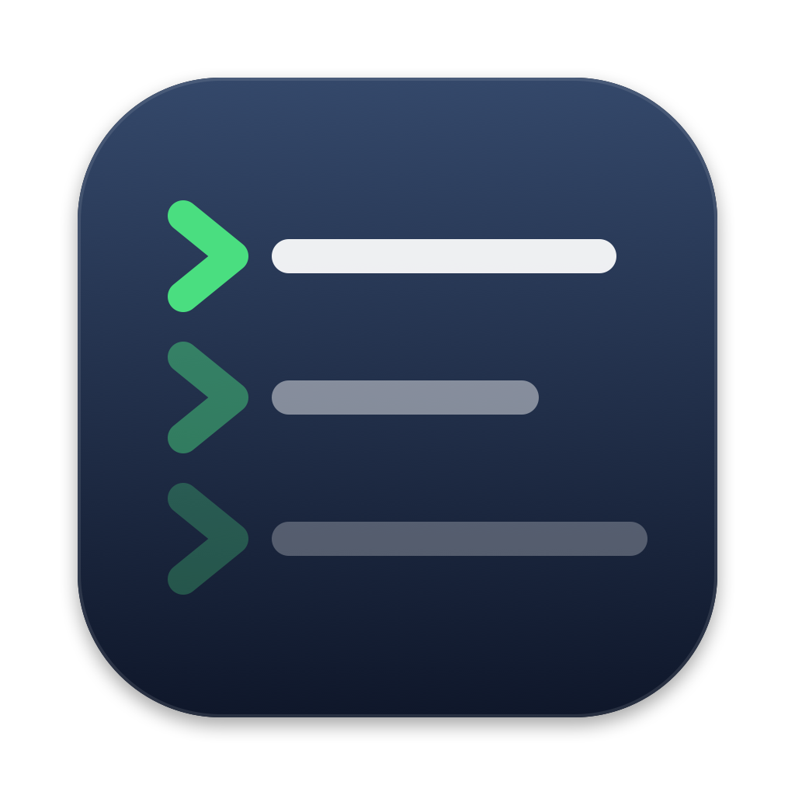

<p align="center">
  
</p>

<h1 align="center">Aguin</h1>

<p align="center">A desktop viewer for the atuin shell history and coding-agent threads</p>

I love Atuin, but sometimes the terminal UI gets in the way, especially for agent thread search. Aguin is a GUI for atuin. Geddit?

Aguin is a desktop app that shows your [atuin](https://atuin.sh/) shell history and the coding-agent threads that atuin captures. You can search, filter and read them in one window.

Aguin opens the atuin databases read-only. It does not change your history, and it updates the view when atuin writes new rows.

## Why

- **Searching the shell history is easier with a window.** The atuin TUI is good for finding a command to run again. It is less good for reading many results, filtering by directory, host or exit status, and seeing the details of each command at the same time.
- **Atuin Desktop is abandoned.** It was the desktop app for atuin (but not your history or agent threads), and there is no maintained replacement.
- **The search in Claude Code is very poor.** It is hard to find an earlier session from its content. atuin now captures agent threads (multiple agents on multiple hosts), and Aguin lets you search their full text, including tool calls and their output.

## Features

- **Shell history tab:** search by command text, filter by directory, host and exit status, and see the details of the selected command.
- **Agent threads tab:** list the threads, show or hide subagent threads, read a transcript with Markdown, diffs and foldable tool calls, find text in one thread, or search all threads.
- Native menus and keyboard shortcuts on macOS (Cmd+1 and Cmd+2 for the tabs, Cmd+F to find, Cmd+Shift+F to search all threads, Cmd+G and Cmd+Shift+G for the next and previous match).
- Light and dark mode follow the system.
- The app remembers the tab, the filters and the selection between starts.

## Requirements

- atuin. Agent threads need an atuin version that captures them (18.24 or later).
- Rust 1.95 or later, to build from source.

## Install

### macOS with Homebrew

```sh
brew tap paour/aguin https://github.com/paour/aguin
brew install --cask aguin
```

The repository is not named `homebrew-…`, so `brew tap` needs its URL. The cask installs `Aguin.app` in `/Applications` and links the `aguin` command into the Homebrew `bin` directory.

### macOS from the release archive

1. Download `Aguin-<version>-macos-universal.zip` from the [releases page](https://github.com/paour/aguin/releases). The app runs on Apple silicon and Intel Macs, with macOS 11 or later.
2. Open the archive and move `Aguin.app` to `/Applications`.
3. Remove the quarantine attribute:

   ```sh
   xattr -dr com.apple.quarantine /Applications/Aguin.app
   ```

**Why step 3 is necessary:** Aguin is not signed with an Apple Developer ID and is not notarized by Apple. It has only an ad-hoc signature. When a browser downloads a file, macOS gives it the `com.apple.quarantine` extended attribute. Gatekeeper checks each quarantined app when it opens for the first time, and it refuses to open an app that Apple has not notarized. The `xattr` command deletes that attribute (`-d`) from the bundle and from all the files in it (`-r`), so that Gatekeeper does not do this check. The Homebrew cask runs the same command after it installs the app.

If you prefer not to use the terminal, try to open Aguin once, then go to **System Settings > Privacy & Security** and click **Open Anyway**.

### Windows

Download `aguin-<version>-windows-x86_64.zip` from the [releases page](https://github.com/paour/aguin/releases), extract it and run `aguin.exe`. The executable is not signed, so SmartScreen can show a warning. Click **More info**, then **Run anyway**.

### Linux

Download `aguin-<version>-linux-x86_64.tar.gz` or `aguin-<version>-linux-aarch64.tar.gz` from the [releases page](https://github.com/paour/aguin/releases), extract it and put `aguin` in a directory on your `PATH`.

### From source

See [Build](#build).

## Build

```sh
git clone https://github.com/paour/aguin.git
cd aguin
cargo build --release
```

The binary is `target/release/aguin`.

On macOS, this script builds an app bundle with the icon, `target/release/Aguin.app`:

```sh
scripts/bundle-macos.sh
```

Copy `Aguin.app` to `/Applications` to start it from Finder or Spotlight.

On Linux, eframe needs some system libraries. See the [eframe documentation](https://github.com/emilk/egui/tree/main/crates/eframe) for the list.

## Usage

```sh
aguin [HISTORY_DB]
```

Without `HISTORY_DB`, Aguin uses `db_path` from the atuin config (`$ATUIN_CONFIG_DIR/config.toml`, else `$XDG_CONFIG_HOME/atuin/config.toml`, else `~/.config/atuin/config.toml`). If the config does not set it, Aguin uses `history.db` in the atuin data directory (`$XDG_DATA_HOME/atuin`, else `~/.local/share/atuin`).

Aguin reads the threads from `threads.db` in the same data directory.

## Contribute

Issues and pull requests are welcome. This includes pull requests written with the help of AI tools. Please review and test the change yourself before you send it, and say in the description which parts an AI tool wrote.

Before you send a pull request, run:

```sh
cargo fmt
cargo clippy --all-targets
cargo test
```

### Release a version

1. Change `version` in `Cargo.toml`, then run `cargo build` to update `Cargo.lock`.
2. Commit, then push a tag with the same version: `git tag v0.2.0 && git push origin v0.2.0`.

The [release workflow](.github/workflows/release.yml) builds and tests Aguin on macOS, Windows and Linux, publishes a GitHub release with the archives, and updates the version and the checksum in `Casks/aguin.rb` on `main`.

## License

Aguin is available under the terms of either of these licenses, at your option:

- the Apache License, Version 2.0 ([LICENSE-APACHE](LICENSE-APACHE))
- the MIT license ([LICENSE-MIT](LICENSE-MIT))

Unless you explicitly state otherwise, any contribution that you intentionally submit for inclusion in Aguin, as defined in the Apache-2.0 license, is dual licensed as above, without any additional terms or conditions.
